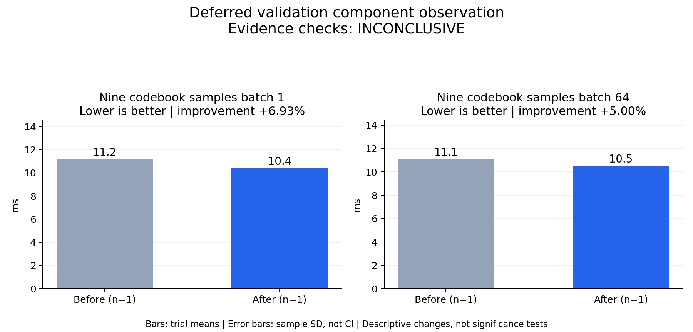

# Deferred validation component observation

Evidence checks: **INCONCLUSIVE**

PASS means supplied evidence checks passed; it does not establish a statistically significant gain.
Means are equally weighted trial means. SD is sample standard deviation, not a confidence interval.

| Metric / scenario | Direction | Before mean ± SD (n) | After mean ± SD (n) | Improvement | Scope |
|---|---|---:|---:|---:|---|
| Nine codebook samples / batch 1 (ms) | lower | 11.1891 ± N/A (n=1) | 10.4141 ± N/A (n=1) | +6.93% | single trial |
| Nine codebook samples / batch 64 (ms) | lower | 11.0904 ± N/A (n=1) | 10.536 ± N/A (n=1) | +5.00% | single trial |



## Input and provenance

```json
{
  "title": "Deferred validation component observation",
  "synthetic": false,
  "context": {
    "hardware": "Ascend 910B1 physical 1",
    "baseline_revision": "f022d5c sampler",
    "candidate_revision": "eb6347b sampler",
    "timing_scope": "nine sampling calls with final device synchronization",
    "source_logs": "deferred-sampling-component.log"
  },
  "checks": {
    "comparable": "unknown",
    "correctness": "pass",
    "lifecycle": "pass"
  },
  "notes": [
    "One process with ABBA order, summarized as one observation per arm, not independent repetitions.",
    "Shared host and possible tiny-model probe overlap; no serving RTF claim.",
    "Exact fixed-seed output equality at batch 1 and 64; root exit 0."
  ],
  "metrics": [
    {
      "name": "Nine codebook samples",
      "scenario": "batch 1",
      "unit": "ms",
      "direction": "lower",
      "before": [
        11.189108528196812
      ],
      "after": [
        10.414061835035682
      ]
    },
    {
      "name": "Nine codebook samples",
      "scenario": "batch 64",
      "unit": "ms",
      "direction": "lower",
      "before": [
        11.090396996587515
      ],
      "after": [
        10.53603459149599
      ]
    }
  ]
}
```
