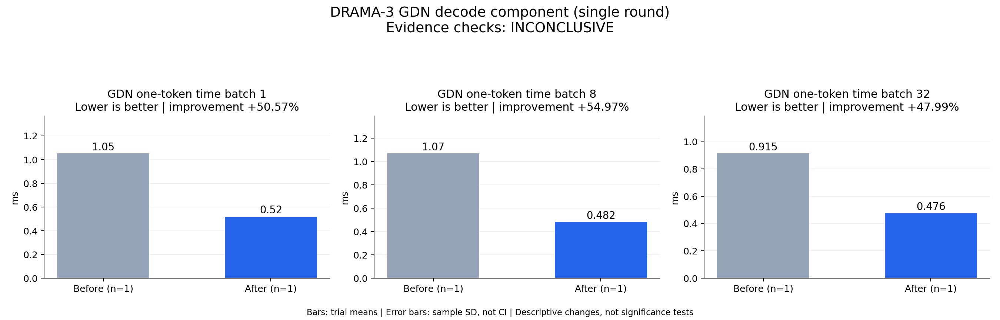

# DRAMA-3 GDN decode component (single round)

Evidence checks: **INCONCLUSIVE**

PASS means supplied evidence checks passed; it does not establish a statistically significant gain.
Means are equally weighted trial means. SD is sample standard deviation, not a confidence interval.

| Metric / scenario | Direction | Before mean ± SD (n) | After mean ± SD (n) | Improvement | Scope |
|---|---|---:|---:|---:|---|
| GDN one-token time / batch 1 (ms) | lower | 1.05265 ± N/A (n=1) | 0.520309 ± N/A (n=1) | +50.57% | single trial |
| GDN one-token time / batch 8 (ms) | lower | 1.07057 ± N/A (n=1) | 0.482052 ± N/A (n=1) | +54.97% | single trial |
| GDN one-token time / batch 32 (ms) | lower | 0.914762 ± N/A (n=1) | 0.475725 ± N/A (n=1) | +47.99% | single trial |



## Input and provenance

```json
{
  "title": "DRAMA-3 GDN decode component (single round)",
  "synthetic": false,
  "context": {
    "hardware": "Ascend 910B1 physical NPU 7",
    "model": "synthetic BF16 q/k/v, 32 heads, D=128, FP32 state",
    "workload": "B1/B8/B32; 5 warmups, 50 timed one-token calls per arm; seed 733",
    "timing_scope": "host wall time with NPU synchronization before and after each 50-call arm; excludes compilation",
    "baseline_revision": "installed Transformers torch_recurrent_gated_delta_rule",
    "candidate_revision": "npu_recurrent.py SHA256 8646d450f0568458c824320422e35e403940d1745d7b8574b64db3b7584e5ae1",
    "command": "tools/probe_standalone_recurrent.py; ASCEND_RT_VISIBLE_DEVICES=7",
    "source_logs": "standalone-gdn-recurrent-multistep.log"
  },
  "checks": {
    "comparable": "unknown",
    "correctness": "pass",
    "lifecycle": "pass"
  },
  "runs": {
    "before": {
      "completed": 150,
      "failed": 0
    },
    "after": {
      "completed": 150,
      "failed": 0
    }
  },
  "notes": [
    "One process, one round, reference then candidate; no independent repeats.",
    "Another baseline is active on different NPUs of the shared host. Timing is exploratory.",
    "One-step and 32-step output/state assertions pass; process exits 0.",
    "This is a GDN component test, not speech throughput, quality, TTFA, RTF or the requested end-to-end 2x result."
  ],
  "metrics": [
    {
      "name": "GDN one-token time",
      "unit": "ms",
      "direction": "lower",
      "scenario": "batch 1",
      "before": [
        1.0526545718312263
      ],
      "after": [
        0.5203088000416756
      ]
    },
    {
      "name": "GDN one-token time",
      "unit": "ms",
      "direction": "lower",
      "scenario": "batch 8",
      "before": [
        1.0705745965242386
      ],
      "after": [
        0.4820520430803299
      ]
    },
    {
      "name": "GDN one-token time",
      "unit": "ms",
      "direction": "lower",
      "scenario": "batch 32",
      "before": [
        0.9147615917026997
      ],
      "after": [
        0.4757246561348438
      ]
    }
  ]
}
```
