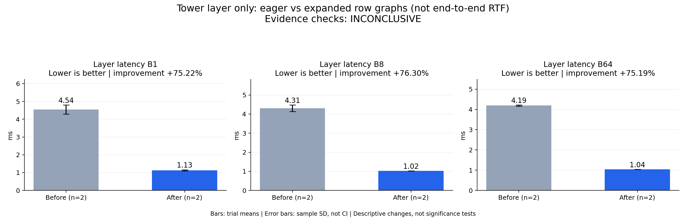

# Tower layer only: eager vs expanded row graphs (not end-to-end RTF)

Evidence checks: **INCONCLUSIVE**

PASS means supplied evidence checks passed; it does not establish a statistically significant gain.
Means are equally weighted trial means. SD is sample standard deviation, not a confidence interval.

| Metric / scenario | Direction | Before mean ± SD (n) | After mean ± SD (n) | Improvement | Scope |
|---|---|---:|---:|---:|---|
| Layer latency / B1 (ms) | lower | 4.54374 ± 0.256299 (n=2) | 1.12612 ± 0.031105 (n=2) | +75.22% | repeated trials |
| Layer latency / B8 (ms) | lower | 4.30511 ± 0.170631 (n=2) | 1.02031 ± 0.000503457 (n=2) | +76.30% | repeated trials |
| Layer latency / B64 (ms) | lower | 4.19008 ± 0.0279107 (n=2) | 1.03944 ± 0.000799758 (n=2) | +75.19% | repeated trials |



## Input and provenance

```json
{
  "title": "Tower layer only: eager vs expanded row graphs (not end-to-end RTF)",
  "synthetic": false,
  "context": {
    "hardware": "Ascend 910B1 physical device 7; shared host",
    "model": "Random BF16 tower layer, dim 2048, FFN 6144, Q heads 16, KV heads 2, head_dim 256",
    "workload": "B1/B8/B64, context 129; identical tensors, 30 calls per arm, ABBA",
    "timing_scope": "Host wall time with NPU synchronization around each 30-call block",
    "baseline_revision": "2d22d59 eager TowerLayer",
    "candidate_revision": "2d22d59 GraphTowerLayer",
    "source_logs": [
      "tower-expanded-graph-abba.log"
    ]
  },
  "checks": {
    "comparable": "unknown",
    "correctness": "pass",
    "lifecycle": "pass"
  },
  "runs": {
    "before": {
      "completed": 180,
      "failed": 0
    },
    "after": {
      "completed": 180,
      "failed": 0
    }
  },
  "notes": [
    "Component result only: no acoustic-frame generation or request RTF measured.",
    "Two timed blocks per arm in one process; not independent process replications.",
    "Concurrent full-model service and quality evaluation shared this host, so formal comparability remains unknown.",
    "Exact eager/graph layer output parity passed; process exited 0.",
    "The baseline here is eager, not the earlier partially captured tower."
  ],
  "metrics": [
    {
      "name": "Layer latency",
      "unit": "ms",
      "direction": "lower",
      "scenario": "B1",
      "before": [
        4.724974899242322,
        4.362513155986865
      ],
      "after": [
        1.1041214068730671,
        1.1481105349957943
      ]
    },
    {
      "name": "Layer latency",
      "unit": "ms",
      "direction": "lower",
      "scenario": "B8",
      "before": [
        4.425761476159096,
        4.184452506403129
      ],
      "after": [
        1.0199555195868015,
        1.020667515695095
      ]
    },
    {
      "name": "Layer latency",
      "unit": "ms",
      "direction": "lower",
      "scenario": "B64",
      "before": [
        4.1703457944095135,
        4.2098174802958965
      ],
      "after": [
        1.0400077017645042,
        1.0388766725858052
      ]
    }
  ]
}
```
