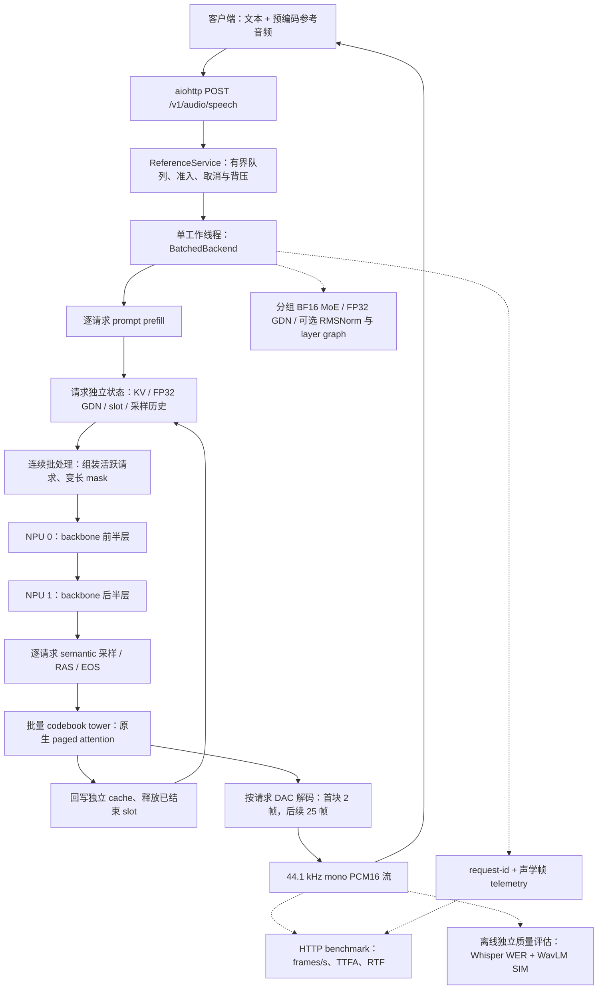

实现独立 DRAMA-3 Ascend 推理框架，支持完整权重加载、连续批处理、请求独立缓存、PCM 流式服务，以及 NPU attention、GDN、RMSNorm 和可选 decoder layer graph。模型与调度路径不依赖 vLLM/SGLang runtime；可选 GDN prefill 使用 sgl_kernel_npu 算子库。

## 验证与范围

- 双 910B1 完整权重 C4 功能验证：4 次 warmup、4 次 measured 请求全部成功，client/server exit 0；独立质量评估 WER 0、mean SIM 59.94（仅 4 条样本）。对应模型代码 `5a74c2e`。
- Graph 实现 `f022d5c`：双 NPU 小模型输出/状态/变长 batch 验证通过；完整权重 C4 请求 4/4 成功，但该 graph 版本的质量和服务退出验证尚未完成。
- 以下数据为单轮观察，不是三框架同条件完成的性能验收；2 倍吞吐目标尚未验证。

## 框架结构

图中为 `--batched` 路径；当前实现为 Python/PyTorch engine，未实现 Rust engine。双卡采用 backbone 层切分，非 TP2；图不表示两个阶段已流水并行。单工作线程驱动 NPU 推理，codebook tower 使用最后一张模型设备。Graph/RMSNorm 为可选实验开关，不属于已完成质量和生命周期验证的 `5a74c2e` 配置。

## 三框架验证对比

下表区分原始 main、NPU 适配、请求成功、质量与进程退出。它补充性能表，不将算子预检当作完整模型推理。

| 验证项 | DRAMA-3 standalone | vLLM-Omni | SGLang-Omni |
|---|---|---|---|
| 被验证实现 | 本地 `5a74c2e` 完整模型；`f022d5c` graph 单独验证 | main `6d29fde` 与 NPU quant 适配 `0eb6f3c` | main `2c23b68` 的 NPU 适配 `0f84b193` |
| NPU 前置验证 | 原生 attention / GDN / RMSNorm 及双卡 cache、graph 状态检查 | main quant method 选择 exit 2；适配后选择 exit 0，仅验证方法选择 | TP2 + BF16 expansion + page16 attention，已执行完整权重请求 |
| 完整权重服务 | C4：4 warmup + 4 measured 全部完成 | NOT_RUN；TP1 限制、完整权重加载及 NPU 执行仍待解决 | C1/2/4/8/16/32 各 128/128 measured 完成；C64 失败 |
| 独立语音质量 | C4 的 4 条：WER 0，SIM 59.9359；小样本 | NOT_RUN | 单独 C8 qualification 的 8 条：WER 0，SIM 60.7748；不是 128 条 sweep 的质量结果 |
| 质量评估后端 | Whisper FP32 NPU ASR + CPU WavLM | 无输出可评估 | Whisper FP32 CPU ASR + CPU WavLM |
| 进程生命周期 | `5a74c2e` client/server/evaluator exit 0；graph 完整服务退出待核验 | main 与适配均为 8 个断言通过后 exit 134；不能记为完整 PASS | sweep 的 C64 TP0 exit -6，出现 heap corruption；该 sweep 非干净完成 |
| 可用于正式加速比 | 否：指定档位及匹配实验不足 | 否：没有完整模型 baseline | 否：单轮共享主机、质量未测齐、C64 失败 |

质量数值来自不同样本数、并发及 ASR 设备，不能据此判断谁的音质更好。已有四条 CPU/NPU Whisper 一致性检查仅覆盖该小样本，不代表所有样本的评估后端等价。本次补充为已有证据核验，没有新跑三框架完整 sweep。

证据：[vLLM 预检与退出状态](https://github.com/amy-why-3459/drama3-engine-npu/blob/feat/standalone-drama3-npu/evidence/campaign-20261017/vllm-validation.json)、[SGLang 各档请求结果](https://github.com/amy-why-3459/drama3-engine-npu/blob/feat/standalone-drama3-npu/evidence/pr-publication/sglang-sweep-status.json)、[SGLang C8 小样本质量](https://github.com/amy-why-3459/drama3-engine-npu/blob/feat/standalone-drama3-npu/evidence/campaign-20261017/sglang-qualification-quality/summary.json)、[独立框架完整模型验证](https://github.com/amy-why-3459/drama3-engine-npu/blob/feat/standalone-drama3-npu/evidence/campaign-20261017/standalone-status.json)、[独立框架质量](https://github.com/amy-why-3459/drama3-engine-npu/blob/feat/standalone-drama3-npu/evidence/campaign-20261017/batched-attempt3/quality/summary.json)。

## C1 / C8 / C16 / C32 / C64 对比

Throughput 单位 frames/s；TTFA 单位 ms；RTF 为 mean，越低越好。`—` 表示未获得有效测量，不能解释为 0。

| 框架 | 并发 | Throughput | TTFA p50 | TTFA p95 | RTF mean | 状态 |
|---|---:|---:|---:|---:|---:|---|
| DRAMA-3 standalone | 1 | — | — | — | — | 未测：已有 C4 功能样本不能替代此档位 |
| vLLM-Omni | 1 | — | — | — | — | 未测：尚无该并发档位完整基线 |
| SGLang-Omni | 1 | 3.166 | 897.24 | 1109.08 | 6.839 | 128/128 请求完成；质量/生命周期未通过完整验收 |
| DRAMA-3 standalone | 8 | — | — | — | — | 未测：已有 C4 功能样本不能替代此档位 |
| vLLM-Omni | 8 | — | — | — | — | 未测：尚无该并发档位完整基线 |
| SGLang-Omni | 8 | 19.428 | 1259.06 | 2873.44 | 8.186 | 128/128 请求完成；质量/生命周期未通过完整验收 |
| DRAMA-3 standalone | 16 | — | — | — | — | 未测：已有 C4 功能样本不能替代此档位 |
| vLLM-Omni | 16 | — | — | — | — | 未测：尚无该并发档位完整基线 |
| SGLang-Omni | 16 | 24.811 | 1787.69 | 8733.08 | 13.192 | 128/128 请求完成；质量/生命周期未通过完整验收 |
| DRAMA-3 standalone | 32 | — | — | — | — | 未测：已有 C4 功能样本不能替代此档位 |
| vLLM-Omni | 32 | — | — | — | — | 未测：尚无该并发档位完整基线 |
| SGLang-Omni | 32 | 31.135 | 3682.73 | 7268.35 | 14.665 | 128/128 请求完成；质量/生命周期未通过完整验收 |
| DRAMA-3 standalone | 64 | — | — | — | — | 未测：已有 C4 功能样本不能替代此档位 |
| vLLM-Omni | 64 | — | — | — | — | 未测：尚无该并发档位完整基线 |
| SGLang-Omni | 64 | — | — | — | — | C64 失败：TP0 exit -6，出现 heap corruption；不报有效性能 |

## 可比性与来源

- SGLang 上游 main 固定为 `2c23b68f4f763c14cfb845eadb4883a5e791b701`，NPU 适配版本 `0f84b193a0e01719cf3a2bb95ff5cfc9d0f3f4e8`。表中数字来自 **NPU 适配版**，不是未修改 main；运行时标记为 `2c23b68-npu-page16-tp-stop-worker-log`。
- vLLM-Omni main 固定为 `6d29fde51c08b2512eafa8778315c2eda745bebe`，NPU 适配预检版本 `0eb6f3c`；尚无完整服务 benchmark。
- 模型 `/dataset/models/drama-3`，HF revision `e0a9218aa48888270f06ef1ed9ea67622c0e17d2`；原始 block-FP8 expert 权重精确展开为 BF16。
- SGLang 使用物理 NPU 0/1、TP2；独立框架使用物理 6/7、层切分。共享主机存在并行实验，未完成独占设备同条件 AB/BA；不能将不同 cohort 的结果计算成正式加速比。
- 英文 SeedTTS 128 条固定 workload SHA256：`9bdd98e981c46225cb7a85362115f2e72e53ca94e17e38154f1e507d3917c2af`。每档 128 measured，warmup max(8, concurrency)。采样 temperature=1、top_p=0.9、top_k=30、max_frames=500；44.1 kHz、hop=2048，初始 chunk 2 帧、后续 25 帧、left context 25 帧。
- Throughput 使用完整 measured cohort wall time 与真实声学帧数；TTFA 为客户端首个音频数据到达，RTF 按音频时长归一化。请求完成、语音质量与进程退出分开判定。
- sweep 在 C64 崩溃后停止，完整 128 条 cohort 的 WER/SIM 尚未执行，不能将 C4 的质量结果套用于其它档位。

证据：`evidence/pr-publication/sglang-sweep-status.json`；完整实现与既有验证见 `README.md` 和 `evidence/campaign-20261017/README.md`。

## 公开发布范围

本 PR 为本地 `fc12301` 的源码快照。上述历史提交号用于本地实验溯源，不属于新公开仓的 Git 历史。未发布模型权重、生成音频、tensor 文件或 SeedTTS 参考音频编码 workload；历史证据中对这些文件的引用仅指本地保留材料。详见 `PUBLICATION.md`。
