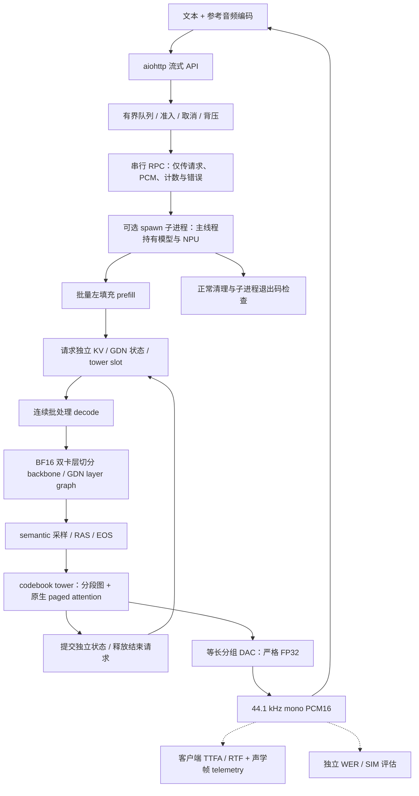

实现独立 DRAMA-3 Ascend NPU 流式推理框架，并补充图执行、批量 prefill、缓存复制优化、严格 FP32 批量 DAC，以及可选的独立推理进程。`--worker-process` 由子进程主线程持有 NPU 模型和图；父进程检查真实退出码。W8A8 专家量化保持实验性、默认关闭。

**当前未达到 C1 RTF < 0.1、C64 RTF < 1；相对 vLLM-Omni / SGLang-Omni 较优框架的 2 倍目标也未验证。** 以下是共享主机单轮观察，不是匹配 AB/BA 加速比。

## 最新完整模型验证

BF16 模型实现对应本地 `4bd2b40`，双 910B1（物理 6/7）按 backbone 层切分，并非 TP2。C1 1 次 warmup + 8 条 measured；C64 64 次 warmup + 64 条 measured。两档请求全部成功，client/server/quality evaluator 均 exit 0。本轮未重现此前图执行版本退出时的 SIGSEGV；不据单次结果宣称全面解决所有历史挂起问题。

| 并发 | measured 成功数 | Throughput frames/s | TTFA p50 ms | TTFA p95 ms | RTF mean | WER corpus | SIM mean |
|---:|---:|---:|---:|---:|---:|---:|---:|
| 1 | 8/8 | 8.577 | 659.45 | 694.20 | 2.5426 | 0.00% | 62.55 |
| 64 | 64/64 | 44.675 | 14727.06 | 14742.13 | 16.9414 | 2.56% | 62.17 |

C64 有一条 measured 请求到达 500 帧上限，必须与质量结果一起解读。WER/SIM 来自 Whisper FP32 NPU ASR + CPU WavLM；未完成匹配基线的音质验收。C1/C64 并非完整 128 条重复轮次 qualification。

## 框架结构

图示为可选 `--batched --worker-process` 路径；默认线程模式仍可用。当前 engine 为 Python/PyTorch，未实现 Rust engine；不依赖 vLLM/SGLang 调度器或模型运行时，可选 GDN prefill 使用 `sgl_kernel_npu` 算子库。双卡层切分不代表流水并行。

## C1 / C8 / C16 / C32 / C64 三框架对照

单位：Throughput frames/s，TTFA ms，RTF mean 越低越好。`—` 表示无有效完整模型测量。样本数、设备分配和后端不同，不能从表中计算正式加速比。

| 框架 | 并发 | Throughput | TTFA p50 | TTFA p95 | RTF mean | 验证状态 |
|---|---:|---:|---:|---:|---:|---|
| standalone BF16 | 1 | 8.577 | 659.45 | 694.20 | 2.543 | 8/8；质量已测；退出 0 |
| vLLM-Omni | 1 | — | — | — | — | 完整模型基线未取得 |
| SGLang-Omni NPU 适配 | 1 | 3.166 | 897.24 | 1109.08 | 6.839 | 128/128；完整质量与生命周期未验收 |
| standalone BF16 | 8 | — | — | — | — | 此版本未测 |
| vLLM-Omni | 8 | — | — | — | — | 完整模型基线未取得 |
| SGLang-Omni NPU 适配 | 8 | 19.428 | 1259.06 | 2873.44 | 8.186 | 128/128；完整质量与生命周期未验收 |
| standalone BF16 | 16 | — | — | — | — | 此版本未测 |
| vLLM-Omni | 16 | — | — | — | — | 完整模型基线未取得 |
| SGLang-Omni NPU 适配 | 16 | 24.811 | 1787.69 | 8733.08 | 13.192 | 128/128；完整质量与生命周期未验收 |
| standalone BF16 | 32 | — | — | — | — | 此版本未测 |
| vLLM-Omni | 32 | — | — | — | — | 完整模型基线未取得 |
| SGLang-Omni NPU 适配 | 32 | 31.135 | 3682.73 | 7268.35 | 14.665 | 128/128；完整质量与生命周期未验收 |
| standalone BF16 | 64 | 44.675 | 14727.06 | 14742.13 | 16.941 | 64/64；质量已测；退出 0；一条达帧上限 |
| vLLM-Omni | 64 | — | — | — | — | 完整模型基线未取得 |
| SGLang-Omni NPU 适配 | 64 | — | — | — | — | TP0 exit -6 / heap corruption |

- SGLang 上游 main `2c23b68f4f763c14cfb845eadb4883a5e791b701`；测量使用 NPU 适配 `0f84b193a0e01719cf3a2bb95ff5cfc9d0f3f4e8`，物理 0/1、TP2。每档 128 measured，warmup=max(8, concurrency)。单独 C8 qualification 的 8 条质量为 WER 0、SIM 60.7748（CPU Whisper），不能代替 sweep 的质量结果，也不能直接与本 PR 不同 cohort 比较音质。
- vLLM main `6d29fde51c08b2512eafa8778315c2eda745bebe`；NPU quant 适配 `0eb6f3c`。main quant method 选择 exit 2，适配后 exit 0，仅证明方法选择；两版预检均有 8 个断言通过后 exit 134。TP1 限制和完整模型执行仍未解决，无可用完整服务性能或音质基线。
- 模型 HF revision `e0a9218aa48888270f06ef1ed9ea67622c0e17d2`；BF16 路径展开原始 block-FP8 专家权重。固定 SeedTTS English 128 条 workload SHA256 `9bdd98e981c46225cb7a85362115f2e72e53ca94e17e38154f1e507d3917c2af`，standalone 本轮取其中前 8/64 条。
- temperature=1、top_p=0.9、top_k=30、max_frames=500；44.1kHz、hop=2048；首块 2 帧、后续 25 帧、left context 25 帧。RTF 是逐请求从发送到最后音频的时间除以输出音频时长，再求均值，包含排队和 prefill，不是总音频吞吐的倒数。

## 实验性 INT8 与拒绝结果

`d7b796e` 添加默认关闭的 `--npu-int8-experts`。发布副本重新运行 45 项 CPU 测试，exit 0；真实形状专家 B1/B3/B8/B64 eager/graph 精确一致、小模型混合长度/请求增删/图缓存测试通过且 exit 0。以上不是 BF16 音质等价证明。

- 单卡 C1：8/8，RTF 2.0154，10.862 frames/s，TTFA 551.64/569.00ms。生成 755 帧，BF16 为 701 帧；语音质量未测，不能宣称等质量加速。
- 单卡 C64：warmup OOM，无有效性能；服务 exit 0。
- 缓存 768（全部输入加最大输出为 625–743 帧）+ expandable segments 重试：C1 图捕获内存地址预留失败，client exit 1、server exit 0，无有效性能。未通过缩短输出规避失败。
- 历史 graph 版本的 exit -11、请求失败和挂起控制均保留为失败证据，未计入通过结果。

## 证据与发布范围

- [最新 BF16 指标、质量与退出状态](https://github.com/amy-why-3459/drama3-engine-npu/blob/feat/standalone-drama3-npu/evidence/campaign-20261017/rtf-process-candidate-result.json)
- [INT8 单卡失败及 C1 观察](https://github.com/amy-why-3459/drama3-engine-npu/blob/feat/standalone-drama3-npu/evidence/campaign-20261017/rtf-int8-single-candidate-result.json)、[缓存重试失败](https://github.com/amy-why-3459/drama3-engine-npu/blob/feat/standalone-drama3-npu/evidence/campaign-20261017/rtf-int8-compact-candidate-result.json)
- [vLLM 验证](https://github.com/amy-why-3459/drama3-engine-npu/blob/feat/standalone-drama3-npu/evidence/campaign-20261017/vllm-validation.json)、[SGLang sweep](https://github.com/amy-why-3459/drama3-engine-npu/blob/feat/standalone-drama3-npu/evidence/pr-publication/sglang-sweep-status.json)
- [完整优化状态](https://github.com/amy-why-3459/drama3-engine-npu/blob/feat/standalone-drama3-npu/evidence/campaign-20261017/rtf-optimization-status.json)

源码快照对应本地 `7bca349a3ac55462dad8250769117c81fad2fdff`，发布时补齐已结束实验状态。上述本地 SHA 用于实验溯源，不属于公开仓 Git 历史。未发布权重、生成音频、tensor 或编码参考音频 workload；详见 PUBLICATION.md。
